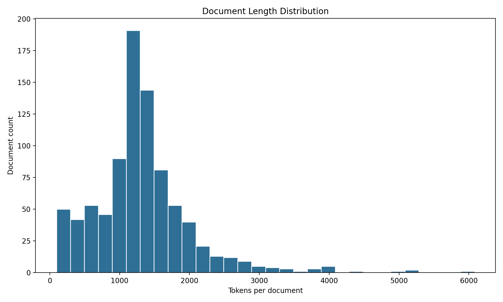
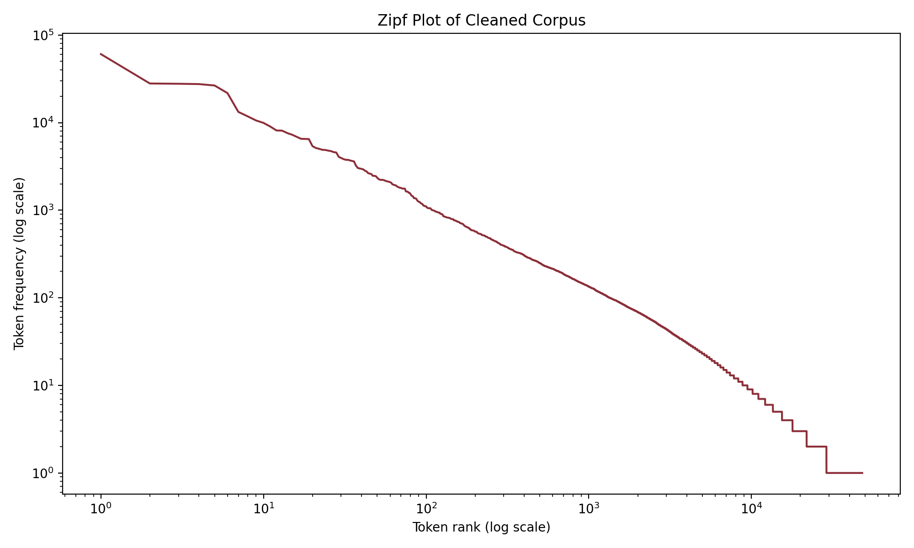
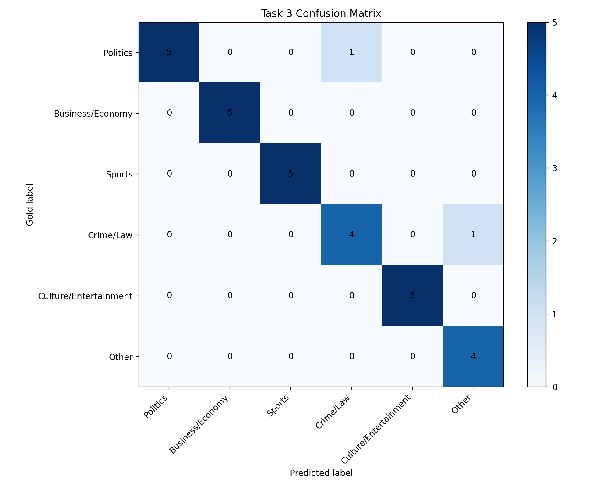

# COMP 4221 NLP Course Project Report

## Project Scope

This project implements the full noisy-news workflow required by the assignment: light preprocessing for an unlabeled corpus, retrieval with two classical bag-of-words ranking models, and a small supervised topic-classification experiment. The annotation pipeline uses a multi-model LLM-assisted labeling approach with cross-provider auditing rather than single-human annotation.

## Task 1: Corpus Audit and Preprocessing

- Documents: `871`
- Total cleaned tokens: `1,147,881`
- Average document length: `1317.89`
- Median document length: `1250.00`
- Vocabulary size before preprocessing: `57,401`
- Vocabulary size after preprocessing: `47,998`

The corpus parser splits documents with the leading `@@<numeric_id>` marker. Cleaning is intentionally light: repeated gap noise is mapped to `<GAP>`, text is lowercased, and whitespace is normalized while punctuation, stopwords, and rare tokens are preserved for downstream interpretability.

## Task 2: Retrieval

- Average TF-IDF `P@5`: `0.76`
- Average BM25 `P@5`: `0.78`
- TF-IDF wins: `3`
- BM25 wins: `3`
- Ties: `4`
- Best BM25 advantage: `Which articles report on basketball, boxing, golf, baseball, or other sports competitions and athlete performance?` (`0.80` vs `0.40`)
- Best TF-IDF advantage: `Which articles cover movies, television, theater, books, or entertainment industry figures?` (`0.80` vs `0.60`)

The retrieval comparison shows a narrow BM25 advantage overall, but the result is query-dependent rather than absolute. BM25 performs better on compact, topic-heavy queries, while TF-IDF remains stronger when exact lexical overlap dominates the information need.

## Task 2 Qrels Validation

- Validation passed: `True`
- Covered ranked rows: `100/100`
- Missing qrels rows: `0`
- Explicit label mismatches: `0`

## Task 3: Topic Classification

- Labeled documents: `200`
- Labeling method: `llm_assisted_with_external_audit`

- Review tag: `direct_review_v2`
- Corrected labels after LLM-assisted review: `19`

- Additional changes from the previous reviewed release: `13`
- Baseline test accuracy / macro-F1: `0.8667` / `0.8561`
- Improved test accuracy / macro-F1: `0.9333` / `0.9330`
- Selected SVM `C`: `1.0`

### Label Distribution

- Politics: 43
- Culture/Entertainment: 37
- Sports: 32
- Business/Economy: 32
- Crime/Law: 31
- Other: 25

### External LLM Audit

- Providers: `vertex, xai`
- Shared audited documents: `200`
- Cross-provider agreement rate: `0.905`
- Unanimous disagreements against the released labels: `0`

### Main Error Pattern

- Crime/Law -> Other (1 cases): `5022441`
- Politics -> Crime/Law (1 cases): `4114241`

The Topic Classification labels were produced by a multi-model LLM-assisted pipeline. Initial seed labels were generated via BM25 topic-query matching (`bootstrap_task3_labels.py`). These seeds were then reviewed document-by-document using GPT-5.4 (Codex), which read each full article and confirmed or corrected the label. Two independent external models (Gemini 2.5 Flash and Grok 4.20) then audited all 200 labels without seeing the current assignments. Documents where both external auditors unanimously disagreed with the released label were re-adjudicated. This pipeline trades single-human annotator judgment for reproducible, auditable multi-model consensus. All audit logs, per-provider review files, and adjudication records are preserved in the repository for full transparency.

## Annotation Methodology

The 200 topic labels were created through a three-stage LLM-assisted pipeline:

1. **Seed generation**: BM25 topic-query matching assigned initial high-confidence labels using keyword queries for each of the six topic categories.
2. **Primary review**: GPT-5.4 (the model driving OpenAI Codex) reviewed each document in full and confirmed or corrected the seed label.
3. **Cross-provider audit**: Gemini 2.5 Flash (Google) and Grok 4.20 (xAI) independently re-labeled all 200 documents. Documents where both auditors unanimously disagreed with the released label were flagged for re-adjudication.

This approach was chosen over single-human annotation to produce a reproducible, auditable label set with cross-model quality checks. The limitation is that all three annotators are LLMs, so shared systematic biases may exist.

### Accuracy Inflation Caveat

Because the seed labels were generated by BM25 keyword matching and the primary review was performed by an LLM, the resulting labels may favor lexically salient topic signals. Since the downstream classifiers (NB and LinearSVC) also rely on bag-of-words features, there is a risk that the reported accuracy reflects a circular fit between the labeling process and the classification model rather than true topic-classification performance. Scores obtained on human-annotated gold labels would likely be lower.

## Reproducibility Notes

- The bootstrap recipe is in `configs/task3_bootstrap.yaml` and can regenerate the seed labels deterministically.
- Per-provider audit logs are stored in `outputs/task3_external_reviews/`.
- The 13 re-adjudicated labels are listed in `configs/task3_review_updates.yaml`.
- The cross-provider audit summary is in `outputs/task3_llm_audit_summary.json`.
- Retrieval relevance judgments were also generated by GPT-5.4 and are stored in `data/annotations/retrieval_qrels.csv`.
- The repository can be rebuilt end-to-end with `bash scripts/run_full_pipeline.sh`.

## Figures

