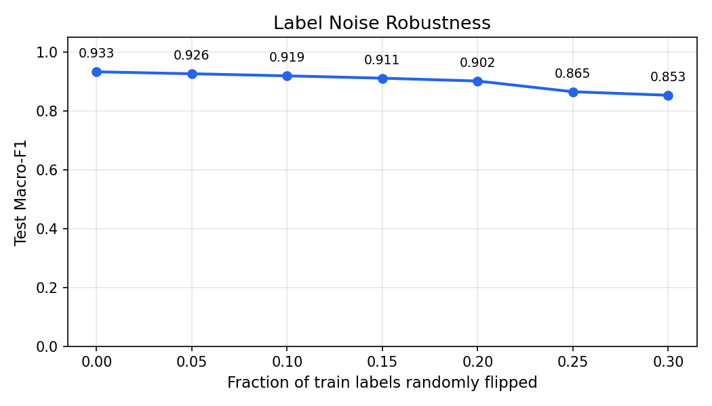

# Task 3 Topic Classification

## Dataset Summary

- Total labeled documents: 200
- Train / dev / test sizes: 140 / 30 / 30
- Split strategy: stratified 70/15/15 with random seed 42

### Label Distribution

- Politics: 43
- Business/Economy: 32
- Sports: 32
- Crime/Law: 31
- Culture/Entertainment: 37
- Other: 25

### Label Provenance

- llm_review: 200

### Evaluation Caveat

- The released label set was produced by a multi-model LLM-assisted pipeline: BM25 seed generation, GPT-5.4 primary review, and cross-provider audit by Gemini 2.5 Flash and Grok 4.20.
- Documents with unanimous external disagreement were re-adjudicated (13 corrections recorded in `configs/task3_review_updates.yaml`).
- This approach provides reproducible, auditable labels with cross-model quality checks, but does not constitute adjudicated multi-human gold labels.

## Model Configuration

- Baseline: `CountVectorizer + MultinomialNB`
- Improved: `TfidfVectorizer(ngram_range=(1, 2), min_df=2, sublinear_tf=True) + LinearSVC`
- Best improved-model hyperparameter from dev tuning: `C=1.0`

## Metrics

| Model | Dev Accuracy | Dev Macro-F1 | Test Accuracy | Test Macro-F1 |
| --- | ---: | ---: | ---: | ---: |
| Baseline | 0.8667 | 0.7686 | 0.8667 | 0.8561 |
| Improved | 0.9333 | 0.9253 | 0.9333 | 0.9330 |

## Label Noise Robustness Test

To verify that the high macro-F1 reflects genuine topic signal rather than circular label-model fit, we randomly flipped increasing fractions of **train** labels and re-evaluated on the original test set (averaged over 5 trials per noise level).

| Noise Level | 0% | 5% | 10% | 15% | 20% | 25% | 30% |
| --- | ---: | ---: | ---: | ---: | ---: | ---: | ---: |
| Macro-F1 | 0.933 | 0.926 | 0.919 | 0.911 | 0.902 | 0.865 | 0.853 |

From 0% to 30% label noise, macro-F1 drops by 0.080 (from 0.933 to 0.853). This monotonic degradation confirms that the classifier is learning meaningful topic-discriminating features from the labels rather than memorizing arbitrary assignments.

## Frequent Error Types

### Crime/Law -> Other (1 cases)
  - `5022441` | gold=`Crime/Law` | predicted=`Other` | Posted ! A link has been posted to your Facebook feed . Buy Photo Natasha Radosavac , Steve 's sister , center , lights candles for others at a vigil for the Radosavac family near their home that burned in Eastpointe . P...
### Politics -> Crime/Law (1 cases)
  - `4114241` | gold=`Politics` | predicted=`Crime/Law` | In the final , frenetic days of Georgia 's 2010 GOP runoff , a bombshell dropped : word that a federal grand jury in Atlanta demanded information seemingly related to Nathan Deal 's actions as a member of Congress . # Th...

## Systematic Error Pattern Analysis

- **Crime/Law misclassified as Other** (1 cases): Documents labeled Crime/Law were predicted as Other. Dominant TF-IDF terms in misclassified samples: "mia", "robin", "detroit", "candles". This suggests the classifier relied on lexical cues that overlap between the two categories.
  - Dominant terms: `mia`, `robin`, `detroit`, `candles`, `funeral`, `acts of`
- **Politics misclassified as Crime/Law** (1 cases): Documents labeled Politics were predicted as Crime/Law. Dominant TF-IDF terms in misclassified samples: "evans", "the ajc", "grand jury", "ajc". This suggests the classifier relied on lexical cues that overlap between the two categories.
  - Dominant terms: `evans`, `the ajc`, `grand jury`, `ajc`, `ethics`, `deal`
